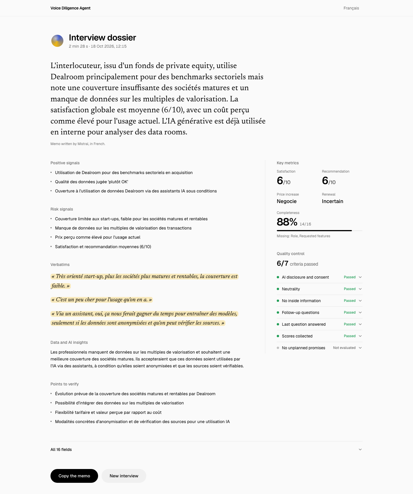
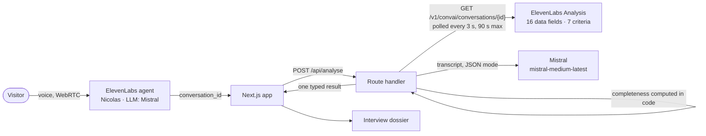

# Voice Diligence Agent

**Nicolas** is an AI voice agent that runs the customer calls of a commercial due diligence on Dealroom: satisfaction, pricing, renewal, AI use.
Each call lasts about 5 minutes. As soon as it ends, it becomes structured data, a binary quality check and an investment memo.
Built with ElevenLabs Agents (voice, analysis) and Mistral (conversation LLM and memo).

**Live demo:** [nicolas-agent.vercel.app](https://nicolas-agent.vercel.app)



> Fictional scenario for demonstration purposes: a due diligence on Dealroom, a VC data platform.
> Not affiliated with Dealroom.co and no information about any real deal.

## How it works



1. **Voice interview.** The browser connects to a public ElevenLabs agent with `@elevenlabs/react`. Mistral drives the conversation.
2. **Extraction and quality control.** Once the call is processed, ElevenLabs Analysis returns 16 Data collection fields and 7 binary evaluation criteria, each with a rationale.
3. **Investment memo.** The server sends the transcript to Mistral in JSON mode. The response is validated with zod, with one retry if it is invalid.

The API keys never leave the server: the browser only knows the public agent ID.

## Design choices

- **Compliance rules live in the agent.** Nicolas discloses that it is an AI and asks for consent (AI Act transparency), refuses inside information, and makes no promise outside its script. Three criteria check these rules after every call.
- **Binary criteria rather than composite scores.** A yes/no question with a rationale ("Did the agent disclose it is an AI?") is more reliable for an LLM evaluator than a 1-to-10 score, and easier to audit.
- **Completeness computed in code.** The completeness rate (non-null fields / 16) and the list of missing fields are deterministic, so data quality does not rely only on an LLM evaluator.
- **Constrained Data collection.** Fields use fixed value lists where possible, and the extractor is told not to infer: an unasked question stays empty instead of being guessed.
- **Mistral for the qualitative memo.** The memo is grounded in the transcript only. Verbatims must be exact quotes, and anything not discussed is marked "Non abordé".

## Run locally

Requirements: Node.js 20+, an ElevenLabs agent configured with the 16 fields and 7 criteria below, and a Mistral API key.

```bash
git clone https://github.com/leopold-dlr/voice-diligence-agent.git
cd voice-diligence-agent
npm install
cp .env.example .env.local   # then fill in the three variables
npm run dev
```

| Variable | Where it is used |
| --- | --- |
| `NEXT_PUBLIC_ELEVENLABS_AGENT_ID` | Browser: public agent ID |
| `ELEVENLABS_API_KEY` | Server only: fetches the processed conversation |
| `MISTRAL_API_KEY` | Server only: writes the memo |

In development, `http://localhost:3000/?conversation=<conversation_id>` replays the analysis of an existing call.

### Smoke test

`scripts/smoke-test.sh` checks a deployment without any key (needs `curl` and `jq`): home page, no server key in the client JS, request validation, and the server-side ElevenLabs key. It exits with code 1 if a check fails.

```bash
./scripts/smoke-test.sh                                   # production
./scripts/smoke-test.sh http://localhost:3000             # local server
CONVERSATION_ID=conv_xxx ./scripts/smoke-test.sh          # + full analysis (one Mistral call)
```

<details>
<summary>Agent configuration (exact identifiers)</summary>

**Data collection (16):** `consentement`, `role_interlocuteur`, `type_structure`, `anciennete_annees`, `usage_principal`, `score_satisfaction`, `donnees_manquantes`, `concurrents_cites`, `reaction_hausse_prix`, `intention_renouvellement`, `score_recommandation`, `usage_ia_actuel`, `position_donnees_ia`, `conditions_ia`, `alerte_confidentialite`, `fonctionnalites_souhaitees`

**Evaluation criteria (7, binary):** `transparence_consentement`, `neutralite`, `conformite`, `relances`, `reponse_derniere_question`, `notes_obtenues`, `aucune_promesse_non_prevue`

</details>

## Stack

Next.js (App Router) · TypeScript · Tailwind CSS · `@elevenlabs/react` · `@mistralai/mistralai` · zod · motion · Vercel

UI components (Orb, Conversation, Message, Shimmering Text, Waveform) come from [ElevenLabs UI](https://ui.elevenlabs.io), open source under the MIT license, installed with the ElevenLabs CLI on top of [shadcn/ui](https://ui.shadcn.com).
